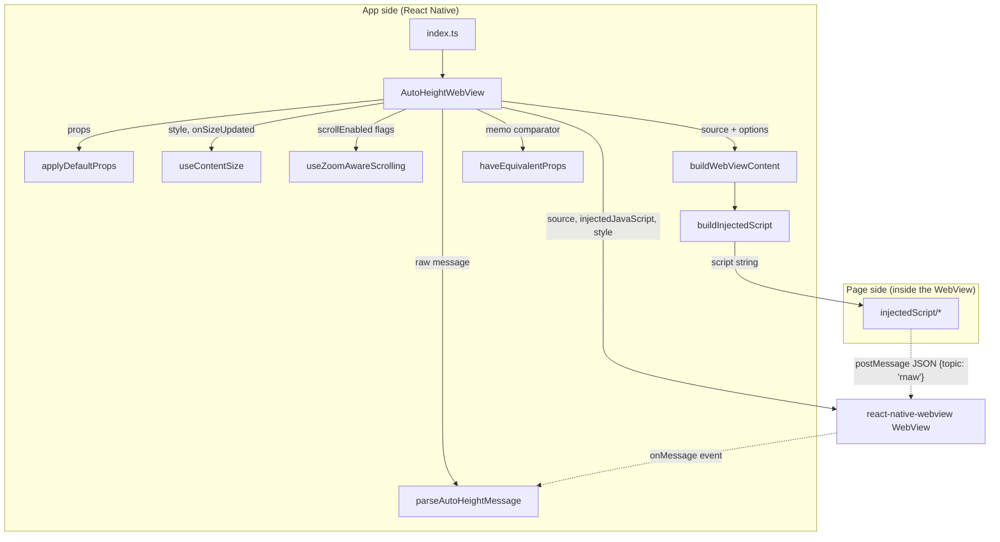
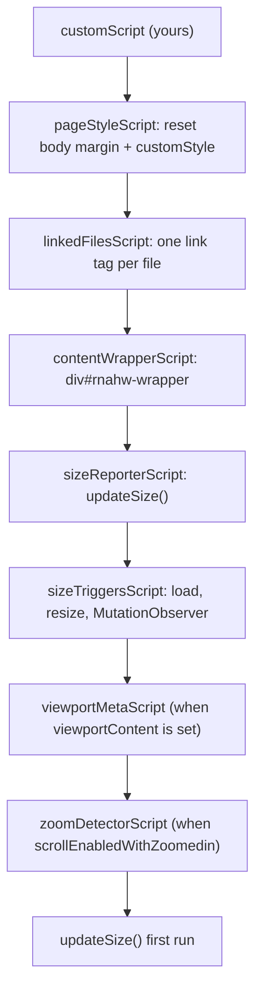

# Architecture

The library has two halves that never share memory. The **app side** is React Native TypeScript code. The **page side** is plain JavaScript injected into the web page as a string. They talk only through JSON messages over the `react-native-webview` bridge.

## Component sketch

How the modules depend on each other. Solid arrows are imports; the dotted arrow is the runtime message channel.

## Injected script layers

The order in which [`buildInjectedScript`](../src/injectedScript/buildInjectedScript.ts#L11) joins the page-side pieces. Each piece may rely on the variables declared by the pieces before it.

## Boundaries and interfaces

| Interface                | Direction     | Shape                                             | Defined in                                                  |
| ------------------------ | ------------- | ------------------------------------------------- | ----------------------------------------------------------- |
| Component props          | You → library | `AutoHeightWebViewProps` (extends `WebViewProps`) | [`types.ts`](../src/types.ts)                               |
| `onSizeUpdated` callback | Library → you | `SizeUpdate {width, height}`                      | [`types.ts`](../src/types.ts)                               |
| `ref`                    | Library → you | The underlying `WebView` instance                 | [`AutoHeightWebView.tsx`](../src/AutoHeightWebView.tsx#L19) |
| Page → app messages      | Page → app    | `ContentSizeMessage` or `ZoomStateMessage`        | [`autoHeightProtocol.ts`](../src/autoHeightProtocol.ts)     |
| Non-library messages     | Page → you    | Passed through to your `onMessage` unchanged      | [`AutoHeightWebView.tsx`](../src/AutoHeightWebView.tsx#L43) |

**External dependencies** (all peers, nothing is bundled): `react`, `react-native` (`Platform`, `Dimensions`, `StyleSheet`) and `react-native-webview`.

## Design decisions

- **Message tagging instead of a separate channel.** The page has only one `postMessage` bridge, so every library message carries `topic: 'rnaw'`. Anything without that tag goes to your own `onMessage` handler.
- **Script built from typed parts.** Message topics and types are TypeScript constants, interpolated into the page script with [`toScriptLiteral`](../src/injectedScript/toScriptLiteral.ts). The two halves can't drift apart, and user values (CSS, URLs, viewport) are always escaped JSON strings.
- **Two ways in, depending on the source type.** For an HTML source, the script is appended inside an isolated function scope ([`webViewContent.ts`](../src/webViewContent.ts#L33)). For a URL source, it goes through `injectedJavaScript`, which `react-native-webview` runs after the page loads.
- **One measured element.** All `<body>` children move into a wrapper `div`, because `body` height is unreliable when it has margins or floating children _(inferred)_.
- **Deep props comparison.** `React.memo` with [`haveEquivalentProps`](../src/propsEquality.ts#L3) avoids rebuilding the script and reloading the page when you pass a new but equal `source` object on every render.
- **Platform defaults that you can override.** Android defaults `scalesPageToFit` to `false`; iOS defaults `viewportContent` to `width=device-width` ([`defaultProps.ts`](../src/defaultProps.ts)). An explicit prop always wins.
