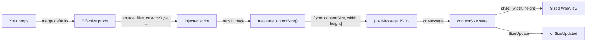
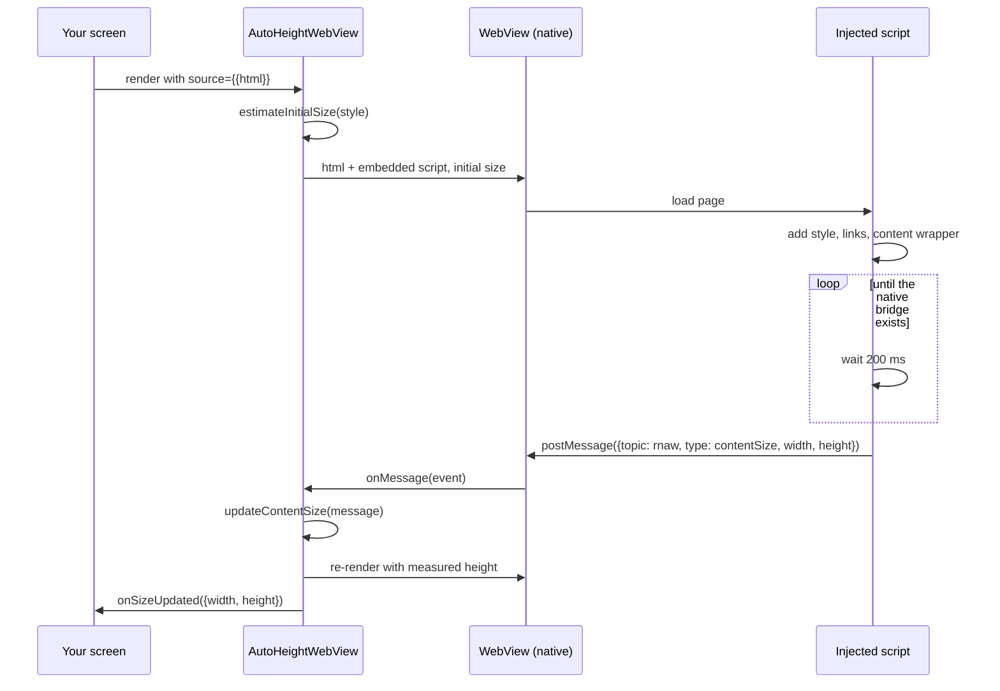
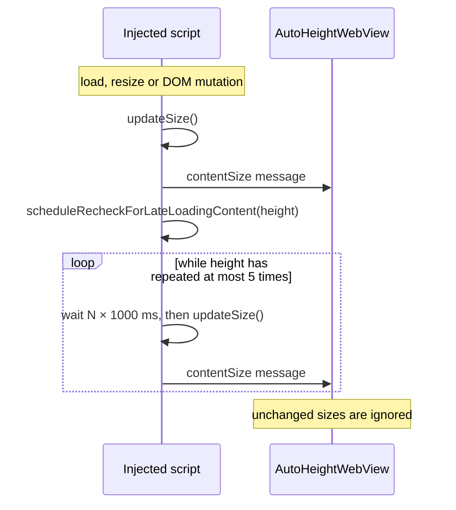
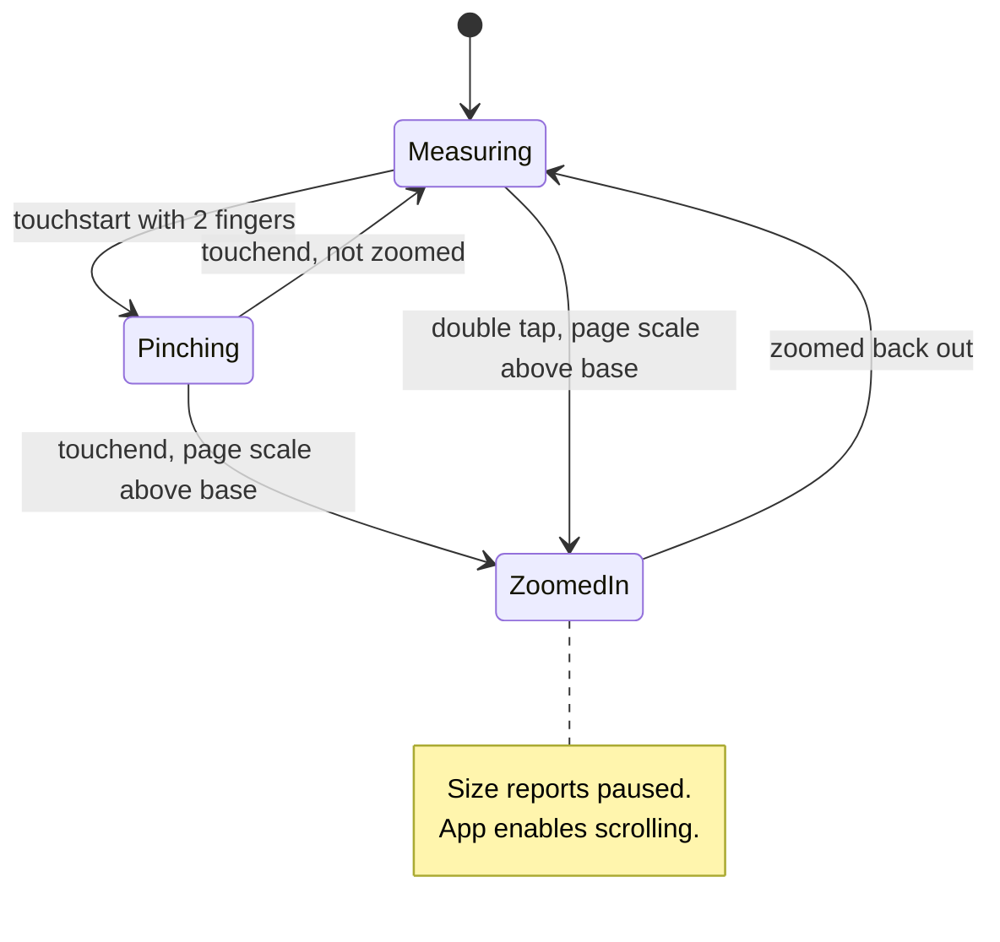

# Flows

## Data flow: from props to the final height

How your props become a correctly sized `WebView`.

1. [`applyDefaultProps`](../src/defaultProps.ts#L18) merges the shared and platform defaults under your props. Props you explicitly set to `undefined` still get their default.
2. [`buildWebViewContent`](../src/webViewContent.ts#L14) builds the script with [`buildInjectedScript`](../src/injectedScript/buildInjectedScript.ts#L11). It then embeds the script in the HTML, or returns it as `injectedJavaScript` for a URL.
3. In the page, [`updateSize`](../src/injectedScript/sizeReporterScript.ts#L50) measures the content wrapper and posts the size. Width is capped at the screen width, and height is multiplied by the page scale.
4. [`parseAutoHeightMessage`](../src/autoHeightProtocol.ts#L23) recognizes the message, and [`useContentSize`](../src/useContentSize.ts#L8) stores the new size if it is non-zero and different.
5. The new size goes into the `WebView` style, _before_ your own `style`. A fixed `height` in your style therefore overrides the measured one.

## Sequence: first render of an HTML source

1. [`estimateInitialSize`](../src/useContentSize.ts#L32) starts with your style's numeric width (or the screen width) and height (or `0`).
2. The script polls every 200 ms until `window.ReactNativeWebView.postMessage` exists, because the bridge can appear after the page script starts.
3. Every message that isn't the library's (wrong topic or not JSON) goes to your `onMessage` instead ([`handleMessage`](../src/AutoHeightWebView.tsx#L43)).
4. `onSizeUpdated` runs from a `useEffect` after each size change, including once for the initial estimate.

## Sequence: content that keeps changing

When the page measures again after the first report.

- **What triggers a measurement:** `load`, `resize`, and a `MutationObserver` on the whole document ([`buildInjectedScript.ts`](../src/injectedScript/buildInjectedScript.ts#L31)) all call `updateSize`.
- **Rechecks for slow content:** [`scheduleRecheckForLateLoadingContent`](../src/injectedScript/sizeReporterScript.ts#L37) keeps measuring with a growing delay, which catches embeds like tweets that grow later. It stops after the height has repeated more than 5 times.

## State: measuring vs. paused (zoom)

Only active when you set `scrollEnabledWithZoomedin` and `scrollEnabled={false}`.

1. [`zoomDetectorScript`](../src/injectedScript/zoomDetectorScript.ts#L4) compares `screen.width / window.innerWidth` with the starting page scale. It posts a `zoomState` message only when the zoom state changes.
2. While pinching or zoomed in, [`isMeasurementPaused`](../src/injectedScript/sizeReporterScript.ts#L46) skips size reports, so a zoomed page doesn't resize the view.
3. [`useZoomAwareScrolling`](../src/useZoomAwareScrolling.ts#L4) turns `scrollEnabled` on while zoomed in, so you can pan around the enlarged page.

## Open questions

- Pinch detection (`touchstart`) never worked in 2.x because of a wrong event name. It works now but hasn't been tested on a real device.
- `event.scale` is non-standard and iOS-only, so on Android zoom changes are caught only through the double-tap path _(inferred)_.
